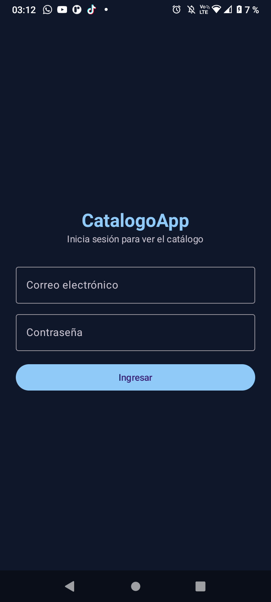
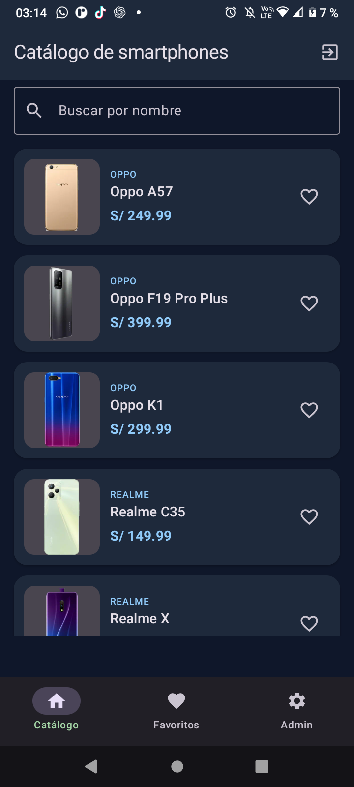
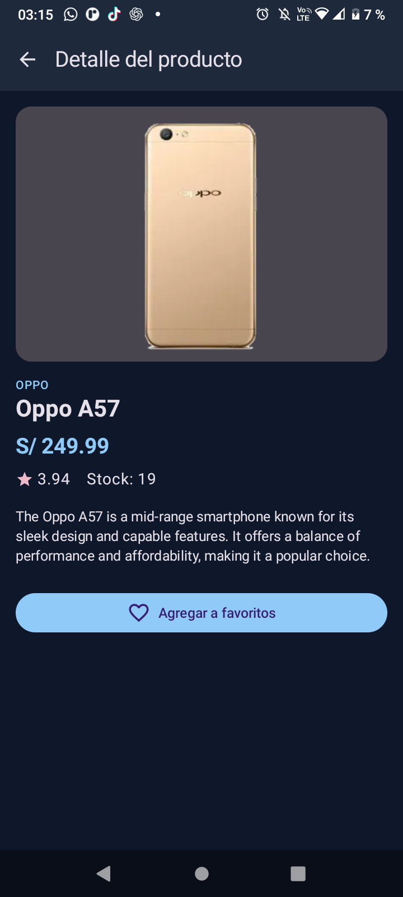
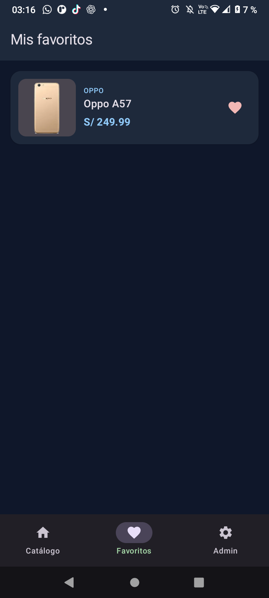
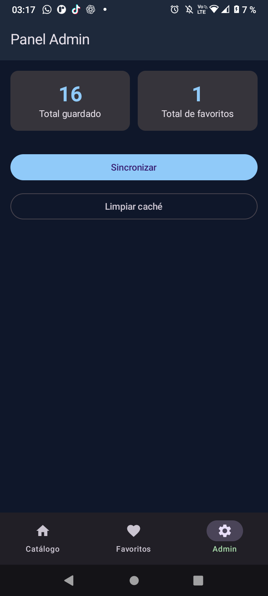
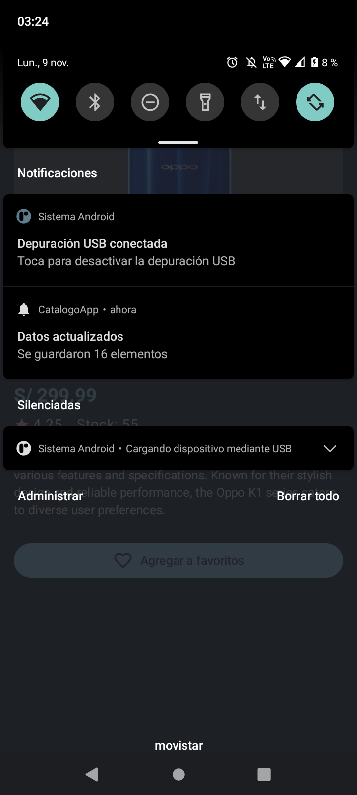
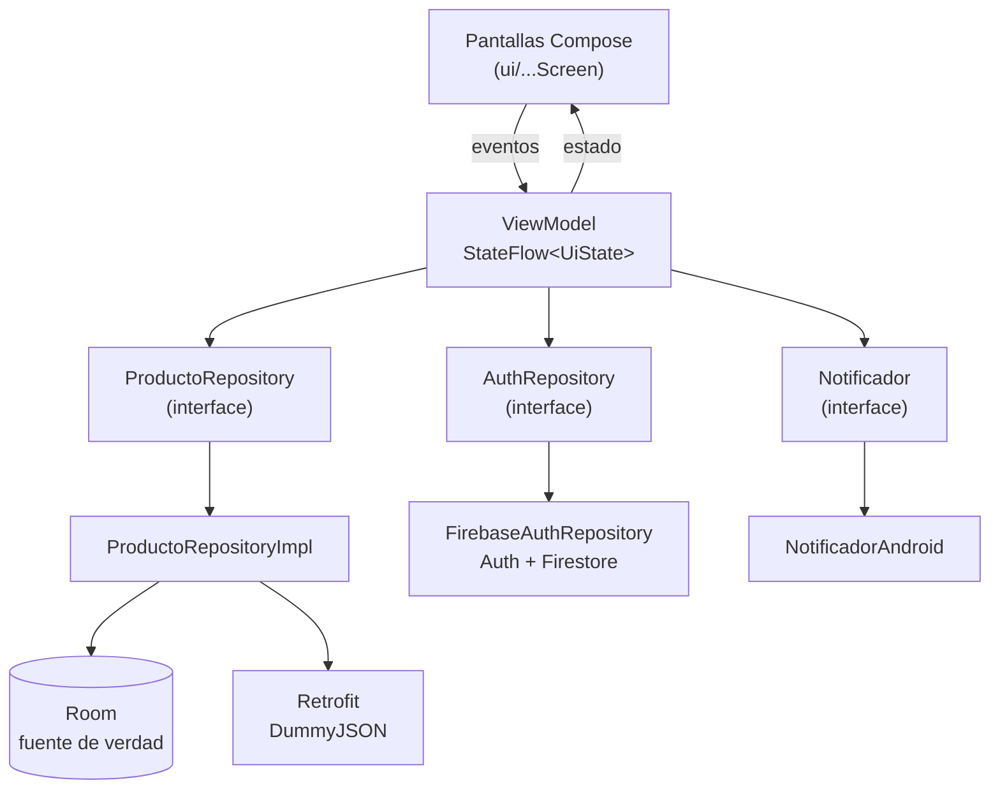

# CatalogoApp — Lab Integrador 11-12

Aplicación Android en Kotlin + Jetpack Compose para consultar **smartphones** de
[DummyJSON](https://dummyjson.com), guardar favoritos, funcionar sin conexión,
iniciar sesión con Firebase y mostrar un panel de administración.

| Dato | Valor |
|---|---|
| Tema | Productos |
| Variante | Smartphones |
| API | `https://dummyjson.com/` |
| Lista | `GET /products/category/smartphones` |
| Detalle | `GET /products/{id}` |
| Paquete | `com.tecsup.catalogo` |
| Integrantes | Leonel · Karim Sovero (`karimSOVC`) |

---

## 1. Qué hace la app

- **Login** con Firebase Auth (correo y contraseña). No hay registro: los
  usuarios los crea el docente. El rol (`admin` o `usuario`) se lee de Firestore.
- **Catálogo** de smartphones con imagen, marca, nombre y precio.
- **Detalle** de cada producto usando el segundo endpoint (`/products/{id}`).
- **Favoritos** que se guardan en Room y sobreviven al cerrar la app.
- **Modo sin conexión**: la lista sale de Room; si no hay internet se muestra el
  aviso «Sin conexión: mostrando datos guardados».
- **Panel Admin** (solo rol `admin`): total guardado, total de favoritos,
  **Sincronizar** y **Limpiar caché**.
- **Notificación local** al terminar de sincronizar: «Se guardaron N elementos».

---

## 2. Tecnologías

| Uso | Tecnología |
|---|---|
| Lenguaje | Kotlin |
| Interfaz | Jetpack Compose + Material 3 |
| Arquitectura | MVVM con `StateFlow` y `UiState` |
| API | Retrofit + kotlinx.serialization + OkHttp |
| Base de datos local | Room (con KSP) |
| Login y roles | Firebase Auth + Cloud Firestore |
| Imágenes | Coil |
| Navegación | Navigation Compose |
| Notificaciones | NotificationCompat |

---

## 3. Capturas

| Login | Lista | Detalle |
|---|---|---|
|  |  |  |

| Favoritos | Panel Admin | Notificación |
|---|---|---|
|  |  |  |

---

## 4. Arquitectura MVVM



Reglas que sigue el proyecto:

- Las pantallas solo observan el estado con `collectAsStateWithLifecycle()` y
  llaman funciones del ViewModel. No usan Retrofit, Room ni Firebase.
- Los ViewModel no reciben `Context`; la notificación se pide con la interfaz
  `Notificador`.
- Los repositorios son **interfaces**; los ViewModel dependen de ellas.
- Hay tres modelos: `ProductoDto` (API), `ProductoEntity` (Room) y `Producto`
  (UI). `Mappers.kt` los convierte.
- **Room es la fuente única de verdad**: la lista sale de Room y Retrofit solo la
  actualiza. Al sincronizar se conservan los favoritos.
- Los ViewModel se crean con un `ViewModelProvider.Factory` que recibe el
  `AppContainer`.

---

## 5. Estructura de paquetes

```text
app/src/main/java/com/tecsup/catalogo/
├── MainActivity.kt
├── AppContainer.kt
├── CatalogoApp.kt
├── data/
│   ├── auth/
│   │   ├── AuthRepository.kt
│   │   └── FirebaseAuthRepository.kt
│   ├── local/
│   │   ├── AppDatabase.kt
│   │   ├── ProductoDao.kt
│   │   └── ProductoEntity.kt
│   ├── mapper/Mappers.kt
│   ├── remote/
│   │   ├── ApiService.kt
│   │   ├── RetrofitClient.kt
│   │   └── dto/
│   │       ├── ProductoDto.kt
│   │       └── ProductosResponseDto.kt
│   └── repository/
│       ├── ProductoRepository.kt
│       └── ProductoRepositoryImpl.kt
├── domain/model/
│   ├── Producto.kt
│   └── Sesion.kt
├── notification/
│   ├── Notificador.kt
│   └── NotificadorAndroid.kt
└── ui/
    ├── UiState.kt
    ├── navigation/AppNav.kt
    ├── login/       (LoginScreen, LoginViewModel, LoginViewModelFactory)
    ├── lista/       (ListaScreen, ListaViewModel, ListaViewModelFactory)
    ├── detalle/     (DetalleScreen, DetalleViewModel, DetalleViewModelFactory)
    ├── favoritos/   (FavoritosScreen, FavoritosViewModel, FavoritosViewModelFactory)
    ├── admin/       (AdminScreen, AdminViewModel, AdminViewModelFactory)
    ├── components/  (Cargando, ErrorView, EstadoVacioView, ProductoCard)
    └── theme/
```

---

## 6. Cómo ejecutar el proyecto

1. Android Studio con **JDK 25** (el proyecto lo pide en
   `gradle/gradle-daemon-jvm.properties`).
2. Clonar el repositorio y abrir la carpeta raíz en Android Studio.
3. `local.properties` con la ruta del SDK (Android Studio lo crea solo). **No se
   sube al repositorio.**
4. Colocar el `google-services.json` del proyecto de Firebase en `app/`. **No se
   sube al repositorio** (está en `.gitignore`).
5. Hacer **Sync Now** y ejecutar en un emulador con Google Play (API 24 o
   superior).

Por consola:

```bash
.\gradlew.bat assembleDebug
```

El APK queda en `app/build/outputs/apk/debug/app-debug.apk`.

> Nota: el KSP `2.2.10-2.0.2` agrega sus fuentes con `kotlin.sourceSets`, que AGP 9
> bloquea por defecto. Por eso `gradle.properties` tiene
> `android.disallowKotlinSourceSets=false`.

---

## 7. Usuarios de prueba y roles

El registro no se programa: los usuarios se crean en Firebase Console.

1. **Authentication → Sign-in method**: activar **Email/Password**.
2. **Authentication → Users → Add user**: crear `usuario@…` y `admin@…`.
3. **Firestore Database**: crear la colección `usuarios`.
4. Para cada usuario, crear el documento `usuarios/{uid}` (el UID sale en
   Authentication) con:

```text
correo: "usuario@…"     rol: "usuario"
correo: "admin@…"       rol: "admin"
```

5. El campo `rol` debe ser exactamente `"admin"` o `"usuario"` (minúsculas).
   Para cambiar el rol de alguien basta con editar ese campo.

---

## 8. Pruebas de aceptación (PA-01 a PA-14)

| Código | Caso | Resultado esperado |
|---|---|---|
| PA-01 | Ingresar con el usuario `usuario`. | Entra al catálogo. No ve el panel Admin. |
| PA-02 | Ingresar con el usuario `admin`. | Entra al catálogo y ve la pestaña Admin. |
| PA-03 | Contraseña incorrecta. | Mensaje de error claro. No entra. |
| PA-04 | Dejar correo o clave vacíos. | Muestra validación. No llama a Firebase. |
| PA-05 | Primera apertura con internet. | Cargando, luego la lista y la notificación «Se guardaron N elementos». |
| PA-06 | Tocar un elemento. | Muestra el detalle con datos del segundo endpoint. |
| PA-07 | Marcar un favorito y cerrar la app. | Al reabrir sigue en Favoritos. |
| PA-08 | Modo avión con datos guardados. | La lista se ve y aparece el aviso de sin conexión. |
| PA-09 | Modo avión sin datos (app recién instalada). | Pantalla de error con botón Reintentar. |
| PA-10 | Sincronizar después de marcar un favorito. | El favorito no se pierde. |
| PA-11 | Admin pulsa Limpiar caché. | La lista queda vacía y los totales en 0. Al sincronizar vuelven los datos. |
| PA-12 | Cerrar sesión y reabrir la app. | Vuelve al login y pide credenciales. |
| PA-13 | Girar la pantalla. | No se pierde el estado ni se vuelve a descargar. |
| PA-14 | Negar el permiso de notificaciones. | La app funciona normal, sin avisos. |

---

## 9. Reparto de tareas

| Integrante | Hitos | Commits en `main` |
|---|---|---|
| Leonel | H1–H6 (proyecto base, estructura MVVM, componentes, lista, Retrofit) + README guía | 9 |
| Karim Sovero (`karimSOVC`) | Correcciones de estructura + H7–H16 (detalle, Room, favoritos, sin conexión, Firebase, login, Admin, notificación, README final) | 11 |

Detalle de los hitos de Karim:

| Hito | Commit |
|---|---|
| Correcciones | `refactor: alinear estructura y contratos con el PDF` |
| H7 | `feat: pantalla de detalle` |
| H8 | `feat: base de datos Room` |
| H9 | `refactor: Room como fuente de verdad` |
| H10 | `feat: favoritos` |
| H11 | `feat: modo sin conexion` |
| H12 | `chore: configurar Firebase` |
| H13 | `feat: login con Firebase Auth` |
| H14 | `feat: roles y panel Admin` |
| H15 | `feat: notificacion local` |
| H16 | `docs: README` |

---

## 10. Para pensar

- **¿Por qué el repositorio es una interfaz?** Porque el ViewModel no necesita
  saber si los datos vienen de Retrofit, de Room o de un repositorio falso en las
  pruebas. Se puede cambiar la implementación sin tocar la pantalla.
- **¿Por qué la lista sale de Room y no de Retrofit?** Para que la app funcione
  sin internet y abra al instante con lo último guardado.
- **¿Qué pasa con los favoritos al sincronizar?** Antes de guardar se leen los
  ids favoritos (`idsFavoritos()`) y se copian a los productos nuevos, así no se
  pierden.
- **¿Dónde se decide el rol?** En Firestore (`usuarios/{uid}`), no en la app. Así
  el docente puede cambiarlo sin publicar otra versión.
- **¿Para qué sirve `UiState`?** Para que cada pantalla tenga un solo estado:
  `Cargando`, `Exito` o `Error`.
- **¿Qué pasa si se niega el permiso de notificaciones?** `NotificadorAndroid`
  revisa el permiso y, si está negado, no muestra nada y la app sigue normal.

---

## 11. Datos de la entrega

| Dato | Valor |
|---|---|
| Número de grupo | _pendiente_ |
| Nombre del repositorio | `lab-integrador-gXX-apellido1-apellido2` (_pendiente_) |
| Usuario de GitHub del docente | _pendiente_ |
| Proyecto de Firebase | `catalogoapp-e7bc0` |

No se suben `google-services.json`, `local.properties`, keystores ni contraseñas.
