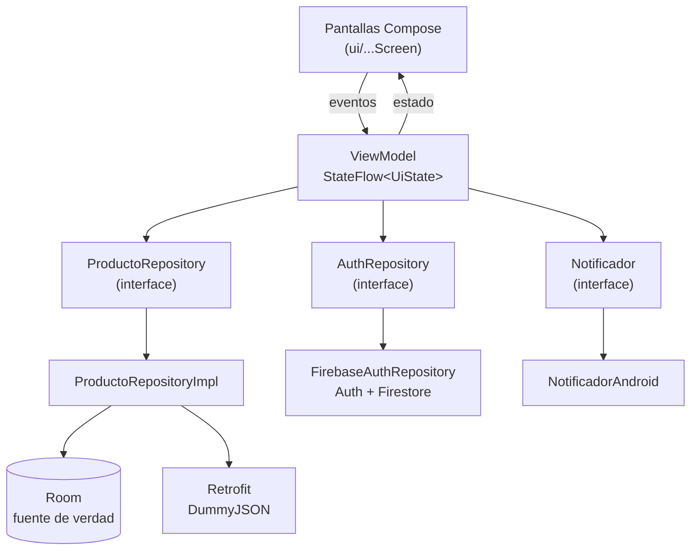

# CatalogoApp — Lab Integrador 11-12

Aplicación Android en Kotlin + Jetpack Compose para consultar **smartphones** de
[DummyJSON](https://dummyjson.com), guardar favoritos, funcionar sin conexión,
iniciar sesión con Firebase y mostrar un panel de administración.

| Dato | Valor |
|---|---|
| Tema | Productos |
| Variante | Smartphones |
| API | `https://dummyjson.com/` |
| Lista | `GET /products/category/smartphones` |
| Detalle | `GET /products/{id}` |
| Paquete | `com.tecsup.catalogo` |
| Integrantes | Leonel Retamozo · Karim Sovero |
| Repositorio | `https://github.com/leonel-m4/LAB12-MOVILES` |

---

## 1. Qué hace la app

- **Login** con Firebase Authentication (correo y contraseña). El rol (`admin` o `usuario`) se lee de Cloud Firestore.
- **Catálogo** de smartphones con imagen, marca, nombre, precio y buscador en tiempo real por nombre.
- **Detalle** de cada producto usando el endpoint `/products/{id}`.
- **Favoritos** persistentes guardados en Room que sobreviven al cerrar la app y al sincronizar.
- **Modo sin conexión**: Room es la fuente única de verdad; si no hay internet se muestra el aviso «Sin conexión: mostrando datos guardados».
- **Panel Admin** (exclusivo para rol `admin`): totales de productos y favoritos, botón **Sincronizar** y **Limpiar caché**.
- **Notificación local** al sincronizar datos: «Se guardaron N elementos».

---

## 2. Tecnologías

| Uso | Tecnología |
|---|---|
| Lenguaje | Kotlin |
| Interfaz | Jetpack Compose + Material 3 |
| Arquitectura | MVVM con `StateFlow` y `UiState` |
| API | Retrofit + kotlinx.serialization + OkHttp |
| Base de datos local | Room (con KSP) |
| Login y roles | Firebase Auth + Cloud Firestore |
| Imágenes | Coil |
| Navegación | Navigation Compose |
| Notificaciones | NotificationCompat |

---

## 3. Capturas de la aplicación

| 1. Login | 2. Catálogo (Lista) | 3. Detalle de Producto |
|:---:|:---:|:---:|
|  |  |  |

| 4. Favoritos | 5. Panel Admin | 6. Notificación Local |
|:---:|:---:|:---:|
|  |  |  |

---

## 4. Arquitectura MVVM



Principios de diseño aplicados:
- **Separación de capas**: las pantallas solo observan estado y llaman funciones del ViewModel; no acceden a Room, Retrofit ni Firebase.
- **ViewModels limpios**: no reciben `Context` de Android.
- **Inversión de dependencias**: los repositorios y el notificador son interfaces.
- **Room como fuente única de verdad**: la UI siempre lee de Room; Retrofit actualiza la base de datos conservando los favoritos existentes.

---

## 5. Estructura de paquetes

```text
app/src/main/java/com/tecsup/catalogo/
├── MainActivity.kt
├── AppContainer.kt                 ← Inyección de dependencias manual
├── CatalogoApp.kt
├── data/
│   ├── auth/                       ← AuthRepository y FirebaseAuthRepository
│   ├── local/                      ← AppDatabase, ProductoDao y ProductoEntity (Room)
│   ├── mapper/Mappers.kt           ← DTO ↔ Entity ↔ Modelo de dominio
│   ├── remote/                     ← ApiService, RetrofitClient y DTOs
│   └── repository/                 ← ProductoRepository y ProductoRepositoryImpl
├── domain/model/                   ← Producto y Sesion (con Rol ADMIN / USUARIO)
├── notification/                   ← Notificador y NotificadorAndroid
└── ui/
    ├── UiState.kt                  ← Sealed interface (Cargando, Exito, Error)
    ├── navigation/AppNav.kt        ← Navegación y protección por roles
    ├── login/                      ← LoginScreen y LoginViewModel
    ├── lista/                      ← ListaScreen y ListaViewModel
    ├── detalle/                    ← DetalleScreen y DetalleViewModel
    ├── favoritos/                  ← FavoritosScreen y FavoritosViewModel
    ├── admin/                      ← AdminScreen y AdminViewModel
    ├── components/                 ← Cargando, ErrorView, EstadoVacioView, ProductoCard
    └── theme/
```

---

## 6. Puesta en marcha

### Requisitos
* Android Studio con JDK 25.
* Dispositivo o emulador con Android 8.0 (API 24) o superior con Google Play.
* Colocar el archivo `google-services.json` dentro de `app/` (ignorado en git por seguridad).

### Compilación y ejecución
```bash
# Compilar APK de depuración
.\gradlew.bat assembleDebug

# Ejecutar pruebas unitarias
.\gradlew.bat testDebugUnitTest
```
El APK generado se encuentra en: `app/build/outputs/apk/debug/app-debug.apk`.

---

## 7. Usuarios de prueba (Firebase)

Los usuarios están creados en Firebase Authentication y su rol asignado en Cloud Firestore (`usuarios/{uid}`):

| Rol | Correo | Contraseña | Acceso a pestaña Admin |
| :--- | :--- | :--- | :---: |
| **Administrador** | `admin@catalogo.com` | `admin123` | **Sí** |
| **Usuario común** | `karim@gmail.com` | `123456` | **No** (oculta) |

---

## 8. Casos de prueba de aceptación (PA-01 a PA-14)

| Código | Caso de prueba | Resultado verificado |
|---|---|---|
| PA-01 | Ingresar con usuario común. | Entra al catálogo; pestaña Admin oculta. |
| PA-02 | Ingresar con usuario admin. | Entra al catálogo y tiene acceso al panel Admin. |
| PA-03 | Contraseña incorrecta. | Mensaje de error claro; no ingresa. |
| PA-04 | Dejar campos vacíos. | Validación local en pantalla sin llamar a Firebase. |
| PA-05 | Apertura con internet. | Muestra estado de carga, catálogo y notificación local. |
| PA-06 | Tocar un producto. | Abre el detalle con datos del segundo endpoint (`/products/{id}`). |
| PA-07 | Marcar favorito y reiniciar app. | El producto permanece en Favoritos. |
| PA-08 | Modo avión con datos en caché. | Catálogo visible y banner «Sin conexión: mostrando datos guardados». |
| PA-09 | Modo avión sin datos previos. | Pantalla de error con botón Reintentar. |
| PA-10 | Sincronizar teniendo favoritos. | Los favoritos marcados no se pierden. |
| PA-11 | Limpiar caché en Admin. | Vacía Room (totales en 0); al sincronizar vuelven los datos. |
| PA-12 | Cerrar sesión y reabrir. | Vuelve al Login y solicita credenciales. |
| PA-13 | Rotación de pantalla. | No pierde el estado ni re-descarga datos de la API. |
| PA-14 | Permiso de notificaciones denegado. | La app sigue funcionando con normalidad sin cerrarse. |

---

## 9. Reparto de tareas

| Integrante | Responsabilidades / Hitos | Commits en `main` |
|---|---|:---:|
| **Leonel Retamozo** | H1–H6: Proyecto base en Compose, arquitectura MVVM inicial, componentes UI, lista con datos de prueba, integración con Retrofit (ApiService y RetrofitClient), reglas de Firestore y documentación. | **10** |
| **Karim Sovero** | Correcciones de estructura y contratos, H7–H16: Pantalla de detalle, base de datos Room, favoritos, modo sin conexión, Firebase Auth, roles y panel Admin, notificación local y Fase 2 en `mejora-ia`. | **11** |

---

## 10. Fase 2 (`mejora-ia`)

En la rama `mejora-ia` se implementaron las siguientes mejoras asistidas por IA:
1. **Búsqueda por nombre**: filtrado reactivo con `StateFlow` y `combine` en `ListaViewModel`.
2. **Pruebas unitarias**: 4 pruebas automatizadas en `ListaViewModelTest` utilizando repositorios y notificador falsos.
3. **Registro de prompts**: documento [`PROMPTS.md`](PROMPTS.md) con el registro y reflexión de las consultas realizadas.
